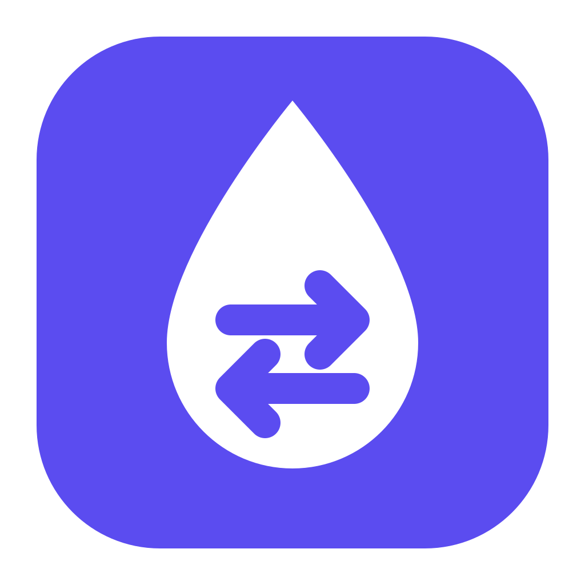
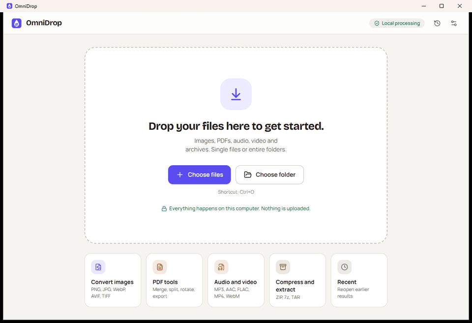
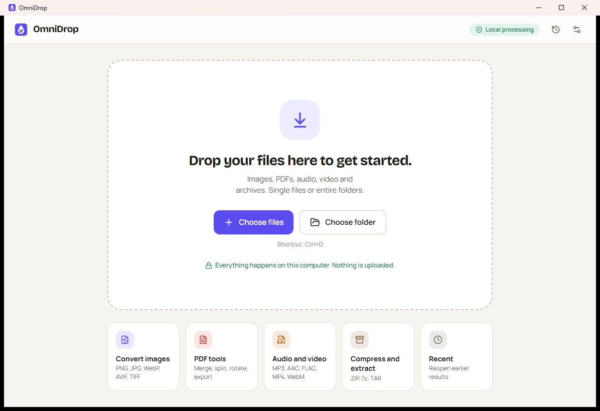
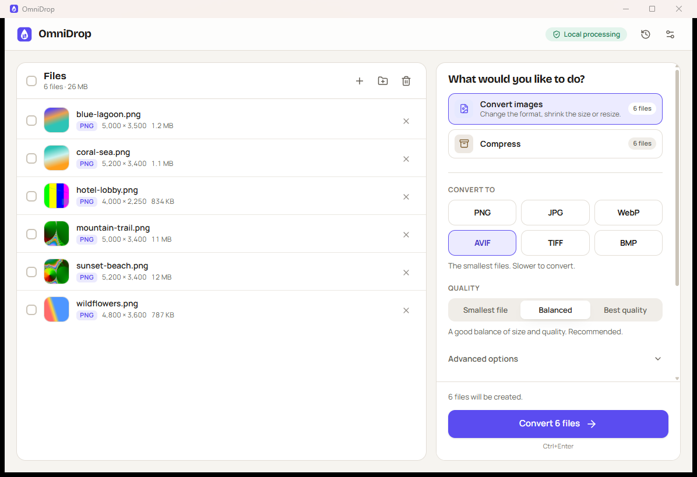
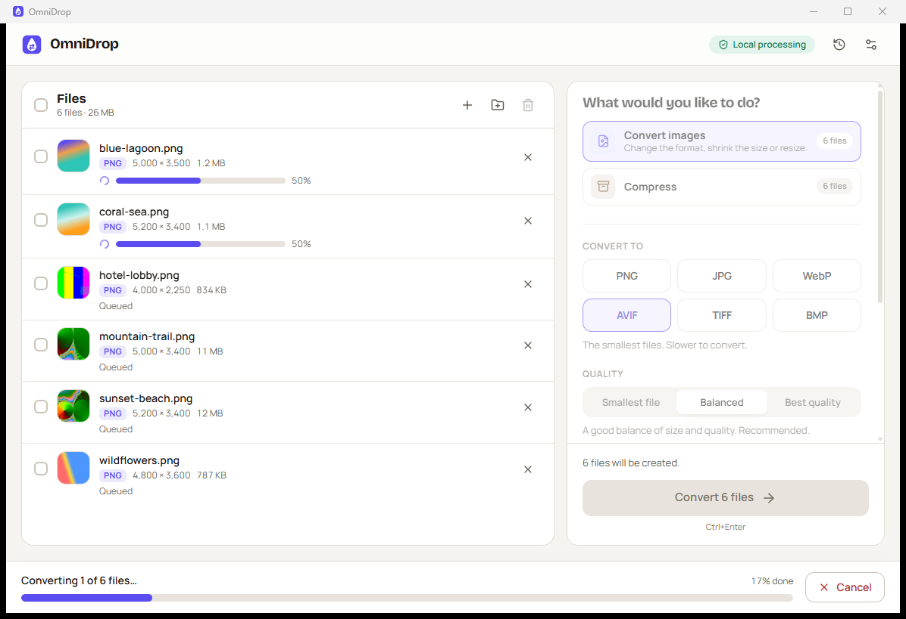
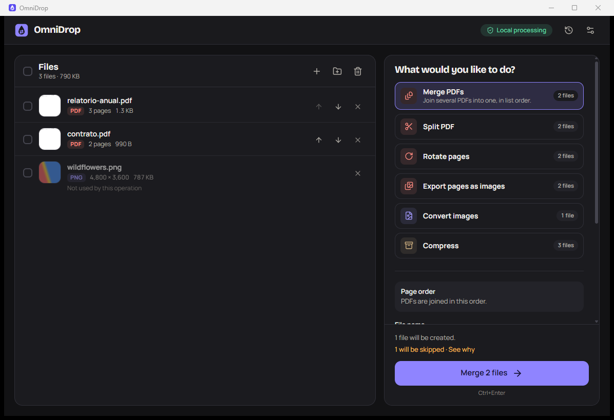

<div align="center">



# OmniDrop

**Drop files in. Get them out converted — privately, on your own computer.**

Convert images, work with PDFs, convert audio and video, and create or extract archives
in a desktop app simple enough that you never need to know what a codec is.

[Download](https://github.com/Ernani1234/Omnidrop/releases/latest) ·
[Supported formats](docs/FORMATS.md) ·
[Privacy](docs/PRIVACY.md) ·
[Build from source](docs/BUILDING.md)



</div>

## Why OmniDrop

- **Simple.** Add files, pick what you want to do, press one button. Sensible presets ("Smallest file", "Balanced", "Best quality") come first; advanced options stay folded away.
- **Private by default.** Everything runs locally. The app makes no network requests, has no telemetry and never uploads a file.
- **Reliable.** Results are written to a temporary file, checked, and only then published. Originals are never changed, and existing files are never silently overwritten.
- **Honest.** An operation is offered only when it is implemented and can run on your machine. If something can't be done, OmniDrop says why in plain language and suggests what to do.
- **Built for batches.** One file or hundreds, with per-file and overall progress, cancellation, and failures that don't stop the rest.
- **Accessible.** Full keyboard use, visible focus, screen-reader labels and announcements, high-contrast light and dark themes, and reduced-motion support. Available in English and Brazilian Portuguese.

## What it can do

| Area | Operations |
| --- | --- |
| **Images** | Convert PNG, JPEG, WebP, TIFF, BMP, GIF and ICO to PNG, JPEG, WebP, AVIF, TIFF or BMP. Resize (fit within a box or by percentage), choose quality, lossless WebP, fill transparency with a colour for JPEG. |
| **PDF** | Merge several PDFs (in list order), split into single pages or ranges, rotate selected pages, export pages as PNG, JPEG or WebP images. |
| **Audio & video** *(uses your FFmpeg)* | Convert to MP3, AAC (M4A), FLAC or WAV, including extracting audio from videos. Convert video to MP4, WebM or MKV, optionally capping resolution or removing audio. |
| **Archives** | Create ZIP, 7z, TAR.GZ or TAR from files and folders. Extract ZIP, 7z, TAR and TAR.GZ safely. |

See the full [format and operation matrix](docs/FORMATS.md), including known limitations.

<table>
  <tr>
    <td></td>
    <td></td>
  </tr>
  <tr>
    <td></td>
    <td></td>
  </tr>
</table>

## Download and install

Get the latest installers from the [Releases page](https://github.com/Ernani1234/Omnidrop/releases/latest):

| System | File |
| --- | --- |
| Windows 10/11 (64-bit) | `OmniDrop_<version>_x64-setup.exe` or `.msi` |
| macOS 11+ (Apple Silicon and Intel) | `OmniDrop_<version>_universal.dmg` |
| Debian, Ubuntu, Mint | `.deb` |
| Fedora, openSUSE | `.rpm` |
| Any other Linux | `.AppImage` |

The builds are not code-signed yet. On **Windows**, choose *More info → Run anyway* if SmartScreen appears. On **macOS**, right-click the app and choose *Open* the first time (or run `xattr -dr com.apple.quarantine /Applications/OmniDrop.app`).

### Audio and video need FFmpeg

OmniDrop uses the FFmpeg already installed on your computer and never downloads it for you.
Install it with `winget install Gyan.FFmpeg` (Windows), `brew install ffmpeg` (macOS) or
`sudo apt install ffmpeg` (Debian/Ubuntu), then click **Settings → Check again**. You can also point
OmniDrop to a specific `ffmpeg` executable. Only the formats your FFmpeg can encode are offered.

## Using OmniDrop

1. Drop files or folders onto the window — or press <kbd>Ctrl</kbd>+<kbd>O</kbd> (<kbd>⌘</kbd>+<kbd>O</kbd> on macOS).
2. OmniDrop reads each file's real format and shows only the operations that apply.
3. Choose a format and a preset. Advanced options are there if you want them.
4. Press **Convert** (or <kbd>Ctrl</kbd>+<kbd>Enter</kbd>). Follow progress per file; cancel any time.
5. When it's done: **Open folder**, **View results**, or **Repeat**.

Results go next to the originals by default, or to a folder you choose. If a name is taken, OmniDrop keeps both
(`photo (1).webp`) unless you choose *Replace* or *Skip* — and it never replaces the file being converted.

| Shortcut | Action |
| --- | --- |
| <kbd>Ctrl</kbd>+<kbd>O</kbd> / <kbd>Ctrl</kbd>+<kbd>Shift</kbd>+<kbd>O</kbd> | Add files / add a folder |
| <kbd>Ctrl</kbd>+<kbd>Enter</kbd> | Start |
| <kbd>Ctrl</kbd>+<kbd>A</kbd>, <kbd>Delete</kbd> | Select all files, remove the selected or focused file |
| <kbd>Ctrl</kbd>+<kbd>,</kbd> | Settings |

## Privacy

OmniDrop processes files on your computer. It does not upload files, does not collect analytics and makes no
network requests of its own. Settings, recent jobs and diagnostic logs stay on your machine and can be removed at
any time. Read the full [privacy policy](docs/PRIVACY.md).

## How it works

```
Files ─► FileInspector ─► CapabilityRegistry ─► OperationPlanner ─► TaskQueue
              (real format,      (what this machine     (validate, resolve   (bounded concurrency,
               metadata)          can actually do)       outputs, explain)    progress, cancel)
                                                                               │
          Publish ◄─ OutputManager ◄─ OutputValidator ◄─ temporary file ◄─ ConversionExecutor
       (never overwrite          (re-read and check the result)              (image, PDF, archive, FFmpeg)
        originals)
```

- **Engine** — [`crates/omnidrop-engine`](crates/omnidrop-engine): pure Rust, no UI dependency, fully tested. Images use [`image`](https://github.com/image-rs/image), libwebp and rav1e; PDFs use [lopdf](https://github.com/J-F-Liu/lopdf) and [hayro](https://github.com/LaurenzV/hayro); archives use `zip`, `tar`, `flate2` and `sevenz-rust2`; audio/video drive FFmpeg with separate arguments, never a shell.
- **Application model** — [`crates/omnidrop-app`](crates/omnidrop-app): settings, history, previews and the typed payloads shared with the UI.
- **Desktop shell** — [`src-tauri`](src-tauri): Tauri 2 commands and native integration. File paths only enter through native drag-and-drop or dialogs; the UI refers to files by id.
- **Interface** — [`src`](src): React 19, TypeScript, Tailwind CSS 4 and Radix primitives. Types are generated from Rust with `ts-rs`, so both sides share one contract.

Read more in [docs/ARCHITECTURE.md](docs/ARCHITECTURE.md), the [product specification](docs/PRODUCT_SPEC.md), the
[design system](docs/DESIGN_SYSTEM.md) and the [architecture decision records](docs/adr).

## Build from source

You need Node.js 22+, Rust (stable) and the [Tauri prerequisites](https://v2.tauri.app/start/prerequisites/) for your system.

```bash
npm ci
npm run tauri dev        # run the app with hot reload
npm run tauri build      # build installers into target/release/bundle
```

Run the checks:

```bash
cargo test --workspace   # engine, application model (media tests run when FFmpeg is installed)
npm test                 # interface tests
npm run typecheck
```

Details, including Linux packages and how releases are made, are in [docs/BUILDING.md](docs/BUILDING.md).

## Limitations

- AVIF can be produced but not read (no AVIF decoder is bundled). HEIC/HEIF is not supported.
- Animated GIF/WebP/APNG: only the first frame is converted (OmniDrop tells you when this happens).
- Editable documents (DOCX, ODT, XLSX…) are recognized but not converted yet.
- PDF merge and split keep pages, text and images, but not bookmarks, forms or links between documents. Password-protected PDFs and archives are not supported.
- Audio and video require a local FFmpeg installation.

## Contributing

Bug reports and pull requests are welcome — please read [CONTRIBUTING.md](CONTRIBUTING.md) and the
[code of conduct](CODE_OF_CONDUCT.md). Security issues: see [SECURITY.md](SECURITY.md).

## License

[MIT](LICENSE) © 2026 Ernani. Third-party components and their licenses are listed in
[docs/THIRD_PARTY.md](docs/THIRD_PARTY.md).
